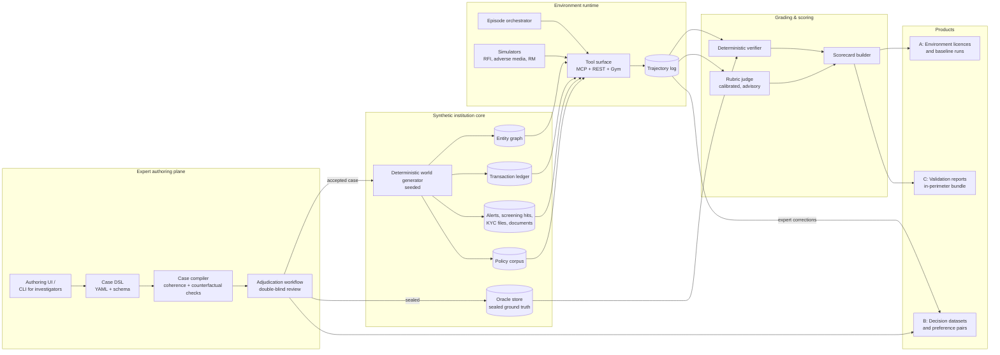

# Financial-Crime AI Platform: Reference Architecture

Status: draft v0.1, 7 November 2026
Scope: the three products in the commercial brief (A: RL investigation environments, B: expert-labeled decision data, C: independent compliance-AI validation)

## 0. What this document does and does not do

This is a systems architecture. It describes the components, the data model, the boundaries between them, the build order, and the risks that the design has to absorb. It does not re-verify the market and pricing claims in the commercial brief (Mercor, Surge, micro1 rates, the Federal Reserve guidance revision). None of the design below depends on those numbers being right. It does depend on one commercial premise: that the unit of sale is an *accepted executable case*, not an hour and not a row of data. Everything here is organised around producing, versioning, grading and licensing that unit.

## 1. The design problem, stated bluntly

Four things will sink this if the architecture does not handle them from the first commit.

1. **The oracle is the product, and it leaks.** An investigation environment is only worth money if the hidden ground truth (what the correct disposition is, and which evidence makes it correct) cannot be inferred from the agent-visible surface by any route other than investigating. If the case author writes the answer and the evidence in the same file and a model can see metadata, naming patterns, record ordering or anything else correlated with the answer, the environment grades pattern matching, not investigation. The oracle must be a separate store with a separate access path, and every case must pass a counterfactual check before it is accepted.

2. **Products A and C consume the same asset and burn it.** A case sold into a lab's training pipeline is contaminated for validation use the moment the lab trains on it. If cases are static files, A and C cannibalise each other. Cases have to be *parameterised generators* with controlled variation, plus strictly partitioned holdout pools with provenance, or C has no credibility.

3. **Realism and verifiability pull in opposite directions.** LLM-simulated customer responses, adverse media and relationship managers make the world feel real and destroy deterministic grading. The rule in this design: nothing stochastic sits on a decisive evidence path. Flavour can be generated. Facts that change the professional decision are authored and fixed.

4. **Banks will not send alert data to a startup's cloud.** Product C only sells if the whole environment, grader and report pipeline can run inside the customer's perimeter. If that is an afterthought, the platform gets rebuilt in year two. The runtime is packaged as a deployable bundle from the start.

The rest of the document is the response to these four constraints.

## 2. System overview



Three planes, one asset. The **authoring plane** is where investigators turn a typology and a narrative into a compiled case. The **world** is the simulated institution the agent sees. The **runtime and grading** planes execute episodes and score them. The three products are different packagings of the same accepted cases.

## 3. Core data model

### 3.1 The case

A case is the atomic sellable unit. It is a directory under version control, compiled into a world snapshot plus a sealed oracle.

```
cases/
  aml/structuring/STR-0042/
    case.yaml            # metadata, typology, difficulty, workflow, licence pool
    narrative.md         # author's account of what actually happened (never exposed)
    entities.yaml        # customers, businesses, UBOs, accounts, counterparties
    ledger.yaml          # transactions and injected patterns, with time anchors
    evidence.yaml        # each evidence item: location, tool path, decisiveness flag
    simulators.yaml      # scripted RFI responses, adverse media hits, RM notes
    oracle.yaml          # correct disposition, decisive evidence set, policy basis
    rubric.yaml          # grading rules: required findings, prohibited actions
    adjudication/        # reviewer verdicts, disagreements, resolution
    variants.yaml        # parameter ranges for generating sibling cases
```

Key fields on `case.yaml`:

| Field | Purpose |
|---|---|
| `typology` | FATF-style typology tag (structuring, layering, funnel account, TBML, mule network, sanctions evasion, PEP exposure, KYB misrepresentation, and so on) |
| `workflow` | Which professional workflow the agent is doing: alert triage, L2 investigation, SAR drafting, KYB onboarding, sanctions hit review, periodic review |
| `difficulty` | Authored estimate plus measured pass rate from baseline runs |
| `pool` | `train`, `public_eval`, `private_eval`, `validation_only`. Movement between pools is one-directional and logged |
| `licence` | Non-exclusive, exclusive-to-customer, or internal-only |
| `coherence_hash` | Hash of the compiled world; changes when any evidence changes |

### 3.2 Evidence and decisiveness

Each evidence item declares where it lives in the world (a transaction, a KYC document field, a screening hit, an RFI answer) and one of three decisiveness classes:

- **Decisive**: removing or inverting it changes the correct disposition.
- **Supporting**: strengthens the rationale but does not change the outcome.
- **Noise**: realistic distractors, including plausible red herrings.

The compiler enforces that every decisive item is reachable through at least one tool path, that decisive items are never produced by stochastic simulators, and that the counterfactual property actually holds (see 5.2).

### 3.3 The oracle

The oracle holds the correct disposition, the decisive evidence set, the policy clauses that justify the decision, the acceptable alternative dispositions (with penalties), and the prohibited actions (for example closing a sanctions hit without screening the beneficial owner, or contacting the customer in a way that constitutes tipping off). It is written to a separate store with a separate service account. The tool surface has no read path to it. Only the verifier does.

### 3.4 World snapshot

Compiling a case produces a world snapshot: a self-contained set of tables and documents that the tool surface serves. Snapshots are immutable and content-addressed. An episode binds to exactly one snapshot and one seed.

## 4. Synthetic institution core

### 4.1 Entity graph

Customers (individuals and legal entities), beneficial owners, directors, accounts, cards, devices, addresses, phone numbers, email domains, counterparties, correspondent banks. Stored relationally in Postgres with an edge table; for graph-shaped queries the runtime materialises a per-snapshot embedded graph (Kùzu or DuckDB with recursive CTEs is adequate at this scale, and keeps the bundle dependency-free). A dedicated graph database is not justified until a single institution exceeds low millions of edges.

### 4.2 Transaction ledger

Event-sourced, append-only, time-anchored. Base traffic is generated from seeded statistical profiles per customer segment so the institution looks alive. Typology patterns are injected by the case author through named injectors (`structuring_below_threshold`, `rapid_in_out`, `funnel_fanin`, `round_tripping`, `trade_mispricing`) with explicit parameters. Injected transactions carry a private tag in the oracle, never in the ledger the agent sees.

### 4.3 Alerts, screening and documents

- **Transaction monitoring**: a small rules engine with the kind of rules real institutions run (velocity, threshold, geography, peer deviation). Alerts carry rule IDs and the fields that triggered them, with realistic false-positive rates.
- **Screening**: fuzzy name matching against synthetic sanctions, PEP and adverse media lists. Public reference lists (OFAC SDN, UN consolidated list) can be used as structure and style references but synthetic names populate the world so no real person is ever implicated.
- **KYC/KYB files**: onboarding forms, ID documents (rendered as PDFs or images where document review is part of the task), ownership charts, source-of-funds declarations, prior review notes.
- **Case history**: prior alerts, prior dispositions, prior RFIs, so the agent has to read what colleagues already did.

### 4.4 Policy corpus

Synthetic institution policies and procedures (AML programme, escalation matrix, SAR filing thresholds, sanctions screening procedure, RFI protocol, record-keeping) plus real public regulatory material (BSA/FinCEN SAR instructions, FATF guidance, OFAC FAQs) that is safe to redistribute. Policy clauses are addressable by ID so the oracle and the agent's rationale can both cite them precisely.

### 4.5 Determinism

Everything in the world is a pure function of `(case, variant parameters, seed)`. Same inputs, byte-identical snapshot. This is what makes grading reproducible, variants cheap, and C's stability testing possible.

## 5. Expert authoring plane

### 5.1 Workflow

1. Investigator picks a typology and workflow from the roadmap.
2. Writes the narrative first (what actually happened), then the evidence, then the oracle. Authoring tools nudge this order because writing evidence before you know the truth produces incoherent cases.
3. Compiler runs. Rejections come back with reasons.
4. Two independent reviewers run the case as an investigator would, through the same tool surface the agent sees, without the narrative or oracle. Their dispositions are compared with the author's.
5. Disagreement goes to a third senior adjudicator. The resolution is recorded, including the reasoning, because disagreement records are themselves valuable Product B material.
6. Accepted case gets a pool assignment and is sealed.

### 5.2 Compiler checks

- **Reachability**: every decisive item is retrievable via a declared tool path within the episode step budget.
- **Counterfactual**: the compiler generates variants with each decisive item removed or inverted and confirms the oracle's disposition changes in the way the author declared. A case whose declared decisive evidence does not actually flip the outcome is rejected.
- **Leakage scan**: no field in the visible world correlates trivially with the disposition (record IDs, timestamps, naming, ordering). Checked statistically across the case bank, not just per case.
- **Stochastic isolation**: no decisive item depends on a simulator with free-text generation.
- **Policy linkage**: every oracle claim cites at least one addressable policy clause.
- **Schema and lint**: boring but necessary.

### 5.3 Who authors

Investigators with real L2/L3, sanctions or KYB experience author and review. Engineers build injectors and tooling. The two roles should not be the same people. Reviewer agreement rates (Cohen's kappa by typology) are tracked and published internally; falling agreement is an early signal that a typology's rubric is under-specified.

## 6. Environment runtime

### 6.1 Interfaces

The same runtime is exposed three ways so that buyers with different stacks can run it without adapters:

| Interface | For |
|---|---|
| **MCP server** | Agent frameworks that speak MCP (Claude, Cursor, most current agent stacks). Each tool below is an MCP tool. |
| **REST/OpenAPI** | Customers' own orchestration, and the validation adapter in Product C. |
| **Gym-style Python** | `env.reset(case_id, seed) -> observation`, `env.step(action) -> (observation, reward, done, info)` for RL training loops. |

### 6.2 Tool surface (v1)

| Tool | Behaviour |
|---|---|
| `search_customers(query)` | Fuzzy search across names, IDs, addresses |
| `get_customer_profile(id)` | KYC/KYB file, risk rating, relationship history |
| `get_ownership(id)` | Beneficial ownership chain |
| `query_transactions(filters)` | Paginated ledger query with the filters a real TM system offers |
| `get_alert(id)` / `list_alerts(filters)` | Alert detail including triggering rule and fields |
| `screen_name(name, dob?, country?)` | Fuzzy screening against lists, returns scored hits |
| `search_adverse_media(query)` | Returns authored and generated articles |
| `get_document(id)` | Returns a document (text, PDF or image) |
| `read_policy(clause_id?)` / `search_policy(query)` | Policy corpus access |
| `send_rfi(customer_id, questions)` | Returns the scripted response after simulated delay; counts against the episode's time budget |
| `add_note(text)` | Working notes, graded for reasoning quality |
| `escalate(to, rationale)` | Terminal or intermediate depending on workflow |
| `close_alert(disposition, rationale, evidence_refs)` | Terminal |
| `draft_sar(structured_fields, narrative)` | Terminal for SAR workflows |

Every tool call, argument and response is logged to the trajectory. Terminal actions must reference evidence IDs, which is what lets the verifier check coverage rather than just the final label.

### 6.3 Simulators

RFI responses, relationship-manager notes and adverse media are **scripted by the author** for anything decisive. A generation layer may paraphrase or pad non-decisive material for variety, behind a flag that is off in `private_eval` and `validation_only` pools. Simulated time advances with actions (an RFI takes "three business days"), so the episode has a realistic cost structure and the agent cannot ask the customer forty questions for free.

### 6.4 Isolation and budgets

One episode, one sandboxed process (container or microVM) bound to one immutable snapshot. Step, token and simulated-time budgets are part of the case definition. Episodes are resumable from the trajectory log for debugging and for the expert-correction loop in Product B.

## 7. Grading and scoring

### 7.1 Deterministic verifier (authoritative)

Runs against the sealed oracle and the trajectory. Produces:

- **Outcome score**: disposition match, with authored penalties for acceptable-but-suboptimal alternatives and heavy penalties for false negatives on reportable activity.
- **Evidence coverage**: fraction of decisive items retrieved, and whether they were cited in the terminal action.
- **Process compliance**: prohibited actions taken (tipping off, closing without required screening, exceeding RFI protocol), required steps skipped.
- **Efficiency**: steps, simulated time, tokens relative to the authored budget.
- **SAR structure** (where applicable): required fields present, dates and amounts consistent with the ledger, subjects correctly identified.

All of this is reproducible and explainable. It is the only component allowed to produce a pass/fail.

### 7.2 Rubric judge (advisory)

An LLM judge scores rationale quality and narrative clarity against the authored rubric. It is calibrated against expert adjudication on a held-out set, its agreement rate is published with every scorecard, and it never changes a pass/fail. Buyers in Product C in particular will ask how the judge was validated; the answer has to be a number, not a description.

### 7.3 Rewards for RL use

Terminal reward from the deterministic verifier. Optional dense signals (evidence retrieved, policy consulted) exposed through the Gym interface with a flag, so labs can choose sparse or shaped training. Shaping signals are documented so nobody is surprised by what the environment rewards.

### 7.4 Scorecard

Per case, per typology, per workflow, per skill (retrieval, reasoning, policy adherence, writing). Includes baseline runs from a small set of reference models so a buyer can see headroom on day one. The scorecard schema is the same object for Products A and C; C adds the stability and calibration sections below.

## 8. Product packaging

### 8.1 Product A: environments

Deliverable is a signed bundle: compiled snapshots for the licensed pool, runtime image, tool surface, verifier, scorecard tooling, baseline runs. Licence terms are enforced in the pool metadata (a `train` licence never includes `private_eval` cases). Customer-specific interfaces (their alert format, their policy manual) are implemented as adapters on top of the same core, not forks.

### 8.2 Product B: decision data

Exported from the same accepted cases plus the adjudication records. Each record: evidence bundle (with tool paths), decision, policy basis, failure taxonomy code when a reviewer or model got it wrong, adjudication metadata (reviewer agreement, resolution). Preference pairs come from the expert-correction loop: a model trajectory replayed, an investigator's corrected terminal action and rationale recorded alongside it. Delivered as JSONL plus a manifest with schema version, case provenance, pool, licence, and a synthetic-data attestation. Inter-rater agreement is a release gate, not a footnote.

### 8.3 Product C: validation

Ships as the same bundle with a **validation adapter** and a **report generator**:

- The adapter maps the customer's AI system to the tool surface. Three modes: the customer's agent calls our MCP tools directly; the customer's system consumes our alert exports in their format and returns dispositions; or we replay the customer's historical alert format through our world (requires a mapping project, priced accordingly).
- Runs are against `validation_only` pools the customer's vendor has never seen, with provenance proof.
- **Stability**: each case run across seeds and variants; disposition flip rate reported.
- **Calibration**: where the customer's system emits confidence, reliability curves against outcomes.
- **Failure taxonomy**: distribution of error classes (missed decisive evidence, wrong policy applied, process violation, hallucinated facts in narrative, over-escalation).
- The report is structured along the lines model-risk teams already recognise from SR 11-7-style validation (conceptual soundness, outcomes analysis, ongoing monitoring), so it slots into existing governance paperwork rather than asking a bank to invent a new one. The brief's note that current guidance excludes generative and agentic AI from formal scope is a reason to mirror the structure anyway: it is what the internal reviewers know how to read.

Deployment: Docker Compose or Helm chart for the customer's VPC or on-prem; an air-gapped tarball variant with no outbound network. Our cloud hosting is the demo path, not the sale.

## 9. Cross-cutting

- **Tenancy and identity**: per-customer tenants; the oracle store is per-tenant and per-pool, with no cross-tenant read path.
- **Audit log**: append-only record of case pool movements, licence grants, every validation run. This is what makes a C report defensible when a vendor disputes it.
- **Contamination defence**: private pools, canary cases (unique, never-licensed cases run periodically against public models to detect leakage), parameterised variants so a burned case can be retired and regenerated in a sibling form, and a public policy on pool rotation.
- **Observability**: episode metrics, tool error rates, judge agreement drift, authoring throughput and reviewer kappa.
- **Metering and billing**: the unit is the accepted case. Floe's existing metering primitives (per-task events with stable IDs, negated reversals, buyer-keyed events) apply directly: every delivered case is an event, every rejection is a negation, and the invoice reconciles to the acceptance log. This is also the cleanest demonstration of Floe's own settlement thesis.
- **Security and compliance**: synthetic-only customer data policy enforced by the generator (no ingestion path for real customer records exists in the platform). Real public reference material is the only external data. SOC 2 Type I within the first year is a sales requirement for C.

## 10. Suggested stack

Kept deliberately boring so the bundle can run inside a bank.

| Concern | Choice | Why |
|---|---|---|
| Language | Python monorepo, typed, `ruff` | Matches existing Floe repos and the RL ecosystem |
| Case schema | YAML validated by Pydantic models | Reviewable in git diffs by non-engineers |
| World storage | Postgres per snapshot; Parquet export | Portable, no exotic dependencies |
| Graph queries | DuckDB recursive CTEs or embedded Kùzu | Avoids a graph DB in the bundle |
| Tool server | FastAPI with an MCP adapter | One implementation, two protocols |
| RL interface | Gymnasium-compatible wrapper | What labs' loops expect |
| Episode isolation | Docker per episode; gVisor or Firecracker where multi-tenant | Deterministic and cheap to ship |
| Orchestration | Temporal (or a Postgres-backed queue early) | Resumable episodes, batch validation runs |
| Judge | Provider-agnostic client; prompts and calibration sets versioned | Buyers will ask which model judged |
| Documents | WeasyPrint/reportlab for PDFs, Pillow for scanned-document rendering | Synthetic KYC artefacts |
| Packaging | Docker Compose, Helm, air-gapped tarball | In-perimeter deployment for C |

## 11. Build sequence against the pilot tiers

| Phase | Weeks | Builds | Enables |
|---|---|---|---|
| 0 | 1 to 6 | Case DSL, compiler with counterfactual check, one typology (structuring), one workflow (alert triage), tool surface v1 with 8 tools, deterministic verifier, 5 accepted cases, MCP and REST | A: discovery tier |
| 1 | 7 to 14 | World generator with base traffic, 3 typologies, SAR workflow, screening tool, scripted RFI simulator, rubric judge with calibration set, baseline runs, bundle packaging, 20 to 30 cases | A: standard pilot; B: evaluation sample |
| 2 | 15 to 26 | Variants engine, pool management and canaries, document rendering, adjudication tooling with kappa tracking, preference-pair capture, validation adapter and report generator, Helm/air-gapped bundle | A: advanced pilot; B: standard pilot; C: first engagement |
| 3 | 27+ | Customer adapters, exclusive pools, ongoing production of cases as a metered service | A exclusive; B production; C recurring |

Team for phases 0 to 2: two engineers (one on world and runtime, one on compiler, grading and packaging), three to five part-time investigator-authors, one senior adjudicator who also owns the rubric. Authoring throughput is the bottleneck, not engineering; the compiler exists to make authoring faster and safer, and it should be measured on cases accepted per author-week.

## 12. Open decisions

1. **Static cases versus generators as the primary asset.** This document says generators, because of the contamination problem. The cost is a harder authoring model. Decide before phase 1; retrofitting variants onto hand-built cases is expensive.
2. **Document review in scope for v1?** Rendering and reading KYC documents makes cases far more realistic and roughly doubles authoring effort per case. Recommendation: text-only in phase 0, rendered documents from phase 2.
3. **How much the judge is allowed to influence a score.** Recommendation here is zero influence on pass/fail. If a buyer wants judge-weighted scores, that is a reporting option, not a grading change.
4. **Where this code lives.** This repository is the org profile. The platform needs its own repository (or two: `fincrime-env` for the world, runtime and grading; `fincrime-cases` private, for the case bank and oracle, with much tighter access).

## 13. Confidence notes

- High confidence: the oracle separation, counterfactual compilation, deterministic-first grading and in-perimeter packaging are the load-bearing decisions. They are consistent with how evaluation and RL-environment vendors handle contamination and with how bank model-risk teams review third-party tools.
- Moderate confidence: the stack choices. They are conservative and interchangeable.
- Low confidence: the phase durations. They assume authoring throughput of roughly two to three accepted cases per investigator-week after tooling settles, which is an estimate, not a measurement. Measure it in phase 0 and re-plan.
- Not assessed here: the market and pricing figures in the brief. The architecture does not depend on them.
